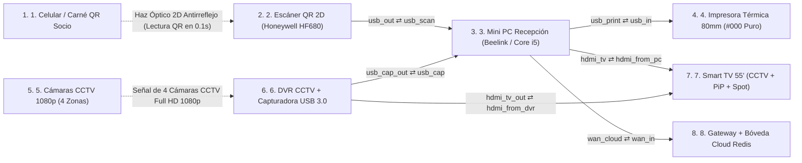

# RD Fitness Club: Escáner QR 2D ➔ Mini PC ➔ Impresora Térmica 80mm + Smart TV 55" CCTV PiP ➔ Cloud Vault

_Despiece Anatómico 3D en Tiempo Real • Rayos-X de Componentes Internos, Boletas Negro Puro (#000) y Smart TV Dual (Cámaras 24/7 + PiP + Publicidad)_

> Documento generado automáticamente por **Anatomy3D** · 2026-10-20T16:40:59.556Z

## Resumen ejecutivo

| Métrica | Valor |
|---|---|
| Equipos | 8 |
| Componentes internos | 43 |
| Etapas de proceso | 27 |
| Cables | 6 |
| Procesos trazables | 3 (20 pasos) |
| Pares de colisión verificados | 40124 |
| Auditoría geométrica | ✅ aprobada (0 errores, 0 advertencias) |
| **Puntaje de calidad** | **100/100** |

## Topología

## Fichas de equipo

### 1. Smartphone del Socio con Carné Digital QR (o Tarjeta PVC RD Fitness)

Representa el teléfono móvil del socio mostrando su Carné Digital de Lujo con marca de agua oficial de RD Fitness Club (o su tarjeta física PVC plastificada). Incluso si la pantalla tiene el brillo al mínimo (15%) o protector de vidrio templado rajado, el código QR de alto contraste es leído al instante al acercarlo al mostrador.

| Especificación | Valor |
|---|---|
| Formato Credencial | Carné Digital PWA (`/`) o Tarjeta PVC Física |
| Payload QR | Token Único `RDFIT:SOCIO` con verificación instantánea |
| Modo Offline | Service Worker `rd-v4.3` (abre el carné sin internet) |
| Distancia Lectura | 5 cm a 25 cm frente al lector 2D manos libres |

**Anatomía interna**

- **Placa Lógica Smartphone ARM64** — Ejecuta la aplicación web progresiva (PWA) de RD Fitness Club con gráficos de asistencia, récords PR y carné QR.
- **Controlador Display AMOLED & Brillo Auto** — Renderiza el vector SVG del código QR con bordes nítidos (`crispEdges`) para lectura inmediata.
- **Motor de Credencial QR (`RDFIT:Mxxxx`)** — Almacena el identificador criptográfico único del socio vinculado a su DNI y plan vigente.
- **Caché Offline Service Worker (`rd-v4.3`)** — Permite que el socio abra su carné QR en la puerta del gimnasio incluso si no tiene megas ni señal móvil.
- **Batería Li-Po 5000 mAh** — Alimentación del dispositivo móvil del socio.

**Proceso interno**

1. **Apertura Instantánea del Carné PWA** — El socio abre la app de RD Fitness Club (con o sin internet gracias al Service Worker local).
2. **Generación del Vector QR de Alto Contraste** — Se despliega el código QR oficial con sello de agua de RD Fitness Club.
3. **Presentación frente al Escáner 2D** — El socio acerca la pantalla a 10–15 cm del lector de mostrador sin entregar su celular.

### 2. Lector Óptico 2D Imager Manos Libres (Honeywell Orbit HF680 / Netum NT-2050M)

Escáner de presentación omnidireccional con base pesada, columna articulada y cabezal óptico CMOS Megapíxel. A diferencia de los lectores láser antiguos de línea roja que rebotan en el vidrio del celular, este sensor fotográfico 2D captura 60 cuadros por segundo con iluminación antirreflejo y decodifica cualquier QR en 0.1 segundos sin fallas.

| Especificación | Valor |
|---|---|
| Modelos Recomendados | Netum NT-2050M (Calidad/Precio) o Honeywell Orbit HF680 (Industrial) |
| Tecnología Óptica | Sensor CMOS 2D Imager 1280×800 px (60 fps) + Luz Blanca Cálida |
| Lectura en Celulares | Lee pantallas con 15% de brillo, vidrio templado rajado y ángulos de 60° |
| Conexión | USB-HID Plug & Play (emula teclado y presiona ENTER en 0.1s) |

**Anatomía interna**

- **Placa Base de Procesamiento Óptico** — Circuito impreso de alta velocidad con bus MIPI CSI directo entre el sensor de imagen y el procesador.
- **Sensor CMOS Megapíxel 1280×800 (60 fps)** — Obturador global (Global Shutter) que congela la imagen del QR aunque la mano del socio esté en movimiento.
- **Conjunto Óptico Asférico Antirreflejo** — Elimina el destello del vidrio de los teléfonos inteligentes para leer pantallas con bajo brillo.
- **Matriz de Iluminación LED Blanca Cálida** — Ilumina uniformemente carnés físicos PVC sin deslumbrar la vista del recepcionista ni del socio.
- **ASIC Decodificador 2D Reed-Solomon** — Reconstruye códigos QR dañados, manchados o con micas quebradas en menos de 100 milisegundos.
- **Buzzer Piezoeléctrico 85 dB + Interfaz HID** — Emite el pitido nítido de confirmación e inyecta la cadena `RDFIT:SOCIO` + `ENTER` por USB.

**Proceso interno**

1. **Captura Global-Shutter a 60 FPS** — El sensor CMOS y el lente antirreflejo capturan el QR del celular sin importar el brillo de pantalla.
2. **Corrección de Errores Reed-Solomon (0.1s)** — El procesador ASIC decodifica la matriz 2D al instante con cero lecturas fallidas.
3. **Pitido de Confirmación + Ráfaga USB-HID** — Activa el LED verde, emite el beep audible y transmite el código con sufijo ENTER a la Mini PC.

| Puerto | Tipo | Cable | Conectado a |
|---|---|---|---|
| Cable USB-HID Blindado (`usb_out`) | rj45 | c_scan_pc | minipc_pos.usb_scan |

### 3. Mini PC de Recepción (Beelink Mini S12 Pro N100 / Core i5 • 16GB RAM • 512GB NVMe • Dual-HDMI)

Estación central compacta de recepción. Su chasis tipo NUC alberga un procesador de 4/6 núcleos, 16 GB de RAM y unidad M.2 NVMe ultrarrápida. Cuenta con doble salida HDMI nativa (una para el monitor del cajero y otra hacia la Smart TV 55" del gimnasio), ejecuta el servidor Node.js local Offline-First y coordina la impresora térmica y la bóveda en la nube.

| Especificación | Valor |
|---|---|
| Modelo Recomendado | Beelink Mini S12 Pro (Intel N100 12va Gen) o HP/Dell Mini Core i5 |
| Memoria y Disco | 16 GB RAM DDR4 + 512 GB SSD M.2 NVMe PCIe (Arranque en 6 segundos) |
| Salidas de Video | 2× HDMI 2.0 4K@60Hz (Monitor Recepción + Smart TV Gimnasio) |
| Base de Datos | Híbrida Transaccional (`gym.json` Local + Upstash Redis Cloud) |

**Anatomía interna**

- **Placa Base Mini-ITX Multicapa Blindada** — Circuito impreso de 6 capas con reguladores digitales VRM y protección contra sobretensiones en todos los puertos USB y HDMI.
- **Procesador Intel Core i5 / N100 + Bloque Cobre** — Ejecuta el servidor Node.js/Express (`server.js`), valida socios en <2 ms y calcula el arqueo ciego de caja.
- **Turbina Radial Blower PWM Silenciosa** — Ventilador centrífugo de rodamiento hidráulico que mantiene el procesador fresco durante 16 horas continuas de operación.
- **16 GB RAM DDR4-3200 SO-DIMM** — Almacena en memoria todo el padrón de socios, sesiones HMAC-SHA256 y el bus de eventos SSE de la Smart TV.
- **SSD M.2 NVMe PCIe 512 GB (`gym.json` + Vault)** — Guarda instantáneamente cada cobro, asistencia y copia de seguridad cifrada AES-256 sin depender de internet.
- **Controladora Dual-HDMI 4K + Captura USB 3.2** — Recibe el video 1080p60 del DVR por USB 3.2 y proyecta `/display.html` hacia la Smart TV del gimnasio por HDMI.

**Proceso interno**

1. **Ingesta USB-HID (QR) + Video DVR (USB 3.0)** — Recibe la lectura instantánea del escáner 2D y el flujo de las 4 cámaras de seguridad.
2. **Validación de Vigencia, Asistencia y Caja** — Verifica los días restantes del socio, registra el ingreso y emite el evento SSE `welcome` / `denied`.
3. **Generación de Boleta Monocromática (#000000)** — Prepara el comprobante térmico en negro puro 100% sin grises y ordena el corte automático.
4. **Guardado Local NVMe + Replicación Cloud** — Asegura el dato en el SSD local en <1 ms y sincroniza la bóveda en la nube Upstash Redis.

| Puerto | Tipo | Cable | Conectado a |
|---|---|---|---|
| USB-HID Escáner 2D In (`usb_scan`) | rj45 | c_scan_pc | scanner_2d.usb_out |
| USB 2.0 Impresora Térmica Out (`usb_print`) | rj45 | c_pc_printer | thermal_printer.usb_in |
| USB 3.0 Capturadora DVR In (`usb_cap`) | rj45 | c_dvr_pc | dvr_capture.usb_cap_out |
| HDMI 2 Out (Hacia Smart TV 55") (`hdmi_tv`) | rj45 | c_pc_tv | smart_tv_55.hdmi_from_pc |
| Gigabit LAN / Cloud Sync Out (`wan_cloud`) | rj45 | c_pc_cloud | cloud_vault.wan_in |

### 4. Impresora Térmica de Boletas 80mm con Autocorte (Xprinter XP-N160II / Epson TM-T20III)

Ticketera térmica de mostrador de 80 mm con forma cúbica real, rollo cilíndrico interno de papel térmico Hansol de 65g, cabezal japonés Rohm de 203 DPI, cuchilla de autocorte automático y boleta impresa emergiendo por la ranura superior. Configurada en modo Monocromático de Alta Densidad (`#000000 !important`) para que cada letra, monto y código QR salga negro intenso y jamás borroso.

| Especificación | Valor |
|---|---|
| Modelos Recomendados | Xprinter XP-N160II (80mm USB/LAN) o Epson TM-T20III |
| Cabezal y Corte | Rohm Japonés 203 DPI (200 mm/s) + Guillotina Automática (1.5M cortes) |
| Papel Requerido | Rollo Térmico 80mm × 80m de 65 gramos (Marca Hansol Capa Negra Intensa) |
| Nitidez Garantizada | CSS `#000000 !important`, `font-weight: 900`, `crispEdges` + Densidad Driver 120% |

**Anatomía interna**

- **Rollo Cilíndrico Papel Térmico 80mm (Hansol 65g)** — Rollo de papel termosensible de 65 g/m² libre de BPA con recubrimiento químico de alto contraste que reacciona en negro profundo.
- **Cabezal Térmico Japonés Rohm 203 DPI** — Línea de 576 micro-resistencias térmicas (8 puntos/mm) que queman el papel al 100% de densidad sólida sin tramado gris.
- **Guillotina Automática de Acero Templado** — Cuchilla motorizada de doble hoja que realiza el corte parcial limpio de la boleta al terminar de imprimir el QR.
- **Motor Paso a Paso + Rodillo Siliconado** — Arrastra el papel a 200 mm/s con presión constante contra el cabezal térmico para evitar líneas pálidas.
- **Placa ESC/POS + Fuente Estabilizada 24V 2.5A** — Mantiene los 24V estables incluso al imprimir logotipos y códigos QR densos en negro sólido.

**Proceso interno**

1. **Recepción del Mapa Monocromático #000000** — La placa ESC/POS recibe el ticket con CSS `#000000 !important` y `contrast(200%)` sin escalas de grises.
2. **Alimentación de Papel Hansol 80mm (65g)** — El rodillo tracciona el papel de alto gramaje hacia la línea de contacto térmico.
3. **Quemado Térmico a 203 DPI de Alta Densidad** — El cabezal Rohm aplica calor pleno produciendo letras, montos y QR en negro intenso y duradero.
4. **Autocorte por Guillotina y Entrega** — La cuchilla de acero corta el ticket automáticamente listo para entregar al socio.

| Puerto | Tipo | Cable | Conectado a |
|---|---|---|---|
| Puerto USB Tipo-B Impresión ESC/POS (`usb_in`) | rj45 | c_pc_printer | minipc_pos.usb_print |

### 5. Cámaras Domo Infrarrojas Full HD 1080p del Gimnasio (Ingreso, Pesas, Cardio, Recepción)

Conjunto de las 4 cámaras de videovigilancia ya instaladas en RD Fitness Club (Puerta Principal, Zona de Musculación, Zona Cardio y Caja). Capturan video continuo a 1080p día y noche y lo envían hacia el DVR para su visualización permanente y en Picture-in-Picture (PiP) en la Smart TV.

| Especificación | Valor |
|---|---|
| Cobertura | 4 Canales Activos (CAM 01 Ingreso, CAM 02 Pesas, CAM 03 Cardio, CAM 04 Caja) |
| Resolución | Full HD 1080p (1920×1080) @ 30 fps con WDR real |
| Visión Nocturna | Anillo Infrarrojo Smart-IR de 30 metros + Filtro IR-Cut |
| Integración TV | Visible 100% del tiempo (Pantalla Completa 90% / Esquina PiP 10%) |

**Anatomía interna**

- **Placa de Captura y Transmisión HD** — Procesa la señal del sensor óptico con aislamiento contra ruidos eléctricos.
- **Sensor CMOS Starlight 2MP 1080p** — Alta sensibilidad lumínica para capturar rostros y movimientos nítidos en todo el gimnasio.
- **Lente Gran Angular 2.8mm (106°) + IR-Cut** — Cubre un ángulo panorámico completo de las máquinas de pesas y la puerta de acceso.
- **Anillo Infrarrojo Smart-IR Automático** — Regula la intensidad infrarroja para evitar sobreexposición en objetos cercanos.
- **Procesador ISP WDR + 3D-DNR** — Compensa el contraluz de la puerta de calle de Chivay para que el ingreso siempre se vea claro.

**Proceso interno**

1. **Captura Óptica Gran Angular (4 Zonas)** — Los lentes de 2.8mm vigilan simultáneamente Ingreso, Pesas, Cardio y Recepción.
2. **Digitalización Full HD 1080p** — El sensor Starlight entrega cuadros nítidos a 30 fps.
3. **Compensación de Contraluz WDR y Envío al DVR** — Envía el flujo de video continuo hacia el grabador DVR del gimnasio.

### 6. Grabador DVR/NVR 4 Canales + Capturadora de Video HDMI-a-USB 3.0 Full HD

Grabador de seguridad del gimnasio con disco duro interno WD Purple (de plato magnético cilíndrico) que graba las 24 horas. Su salida HDMI pasa por un Splitter y una Capturadora HDMI-a-USB 3.0 (S/ 45) hacia la Mini PC, logrando que el video en vivo de las cámaras se integre dentro de `/display.html` sin perder jamás la grabación ni la vigilancia.

| Especificación | Valor |
|---|---|
| Grabador | DVR/XVR 4 Canales 1080p H.265+ con Disco WD Purple 24/7 |
| Enlace a Mini PC | Capturadora de Video HDMI-a-USB 3.0 UVC 1080p60 (Plug & Play) |
| Modo en `/display.html` | Detección directa por navegador (`getUserMedia`) o Stream IP/MJPEG |
| Seguridad | Grabación continua 24/7 independiente de lo que muestre la pantalla |

**Anatomía interna**

- **Placa Madre DVR 4 Canales + AFE** — Digitaliza las 4 entradas de cámaras con protección contra picos en los cables coaxiales.
- **Disco Duro WD Purple 24/7 (Plato Magnético)** — Almacenamiento de videovigilancia continua con plato giratorio de aluminio para grabación 24/7 sin pérdida de cuadros.
- **SoC Codificador H.265+ Multi-Vista 2×2** — Comprime el video para el disco duro y compone en tiempo real el mosaico cuádruple de las 4 cámaras.
- **Splitter HDMI Activo 1×2 (1080p60)** — Divide la salida de video de alta definición sin caída de señal.
- **Capturadora HDMI-a-USB 3.0 (Chip UVC)** — Convierte la salida HDMI del DVR en un flujo USB 3.0 de 60 fps que `/display.html` muestra a pantalla completa y en modo PiP.

**Proceso interno**

1. **Grabación Ininterrumpida 24/7 en WD Purple** — Las 4 cámaras se graban en disco continuamente sin importar qué alerta o spot esté en la TV.
2. **Generación de Cuadrícula 2×2 con Sello REC** — El procesador H.265+ arma la vista de las 4 zonas del gimnasio en tiempo real.
3. **Inyección HDMI-a-USB 3.0 hacia `/display.html`** — La capturadora entrega el video en vivo a la Mini PC para proyectarlo en la Smart TV 55".

| Puerto | Tipo | Cable | Conectado a |
|---|---|---|---|
| Salida Capturadora HDMI-USB 3.0 a Mini PC (`usb_cap_out`) | rj45 | c_dvr_pc | minipc_pos.usb_cap |
| Bus Video HDMI hacia Smart TV 55" (`hdmi_tv_out`) | rj45 | c_dvr_tv | smart_tv_55.hdmi_from_dvr |

### 7. Smart TV 55" 4K del Gimnasio: Cámaras CCTV 24/7 + Ventana PiP + Alertas QR/Yape + Spot Publicitario

Televisor panorámico vertical de 55 pulgadas del gimnasio que reemplaza por completo a la Tablet. El 90% del tiempo muestra las 4 cámaras de seguridad a pantalla completa. Cuando un socio escanea su QR o hace un Yape, las cámaras se encogen automáticamente a un recuadro Picture-in-Picture (PiP) en la esquina inferior derecha por 5.5s mientras aparece la bienvenida o el QR de pago. Además, cada 3 minutos proyecta un Spot Publicitario de 16s con los planes del gimnasio.

| Especificación | Valor |
|---|---|
| Formato Físico | Pantalla Panorámica Vertical 50"–55" 4K UHD conectada por HDMI |
| Modo Base (90% tiempo) | 4 Cámaras CCTV del Gimnasio a Pantalla Completa en Vivo |
| Alertas Prioritarias (5.5s) | Ingreso QR (Verde), Salida (Azul), Vencido (Rojo) y Cobro Yape/Plin con CCTV en PiP |
| Publicidad Rotativa (16s) | Spot Automático cada 3 min (Planes S/5 y S/90 + App Socio) con CCTV en PiP |

**Anatomía interna**

- **Matriz Vertical Direct-LED 55" 4K UHD** — Panel vertical de alto brillo (450 nits) visible desde las máquinas de pesas, cardio y recepción.
- **Placa T-CON 60Hz & Mainboard Smart TV** — Controla el refresco de los 8.3 millones de píxeles sin parpadeos durante las transiciones.
- **Conmutador Inteligente de Escena (`display.html`)** — Escucha el stream SSE `/api/screen/stream` y da prioridad absoluta a las entradas QR (5.5s) y cobros Yape.
- **Motor Picture-in-Picture (PiP CCTV en Esquina)** — Encoge suavemente las 4 cámaras a la esquina inferior derecha durante una alerta o anuncio para no perder vigilancia.
- **Programador de Spots Publicitarios (Cada 3 min)** — Lanza automáticamente durante 16 segundos las tarifas, promociones y beneficios de RD Fitness Club y luego devuelve las cámaras a pantalla completa.
- **Altavoces Estéreo 20W + Sintetizador WebAudio** — Reproduce la campanilla de bienvenida, la alarma grave de membresía vencida y la fanfarria de pago Yape.

**Proceso interno**

1. **Monitoreo Base: 4 Cámaras CCTV a Pantalla Completa** — El 90% del día la TV exhibe las 4 cámaras de seguridad del gimnasio en alta definición.
2. **Activación Automática de Picture-in-Picture (PiP)** — Ante un escaneo QR, cobro Yape o turno publicitario, las cámaras pasan al recuadro flotante PiP.
3. **Alerta de Bienvenida QR / Yape (5.5s)** — Muestra en grande la foto del socio, sus días restantes o el QR de Yape con aviso sonoro.
4. **Spot Publicitario Rotativo (16s) y Retorno a CCTV** — Cada 3 minutos proyecta los planes del gimnasio por 16s y restaura automáticamente las cámaras a pantalla completa.

| Puerto | Tipo | Cable | Conectado a |
|---|---|---|---|
| HDMI 1 (Bus Video DVR CCTV) (`hdmi_from_dvr`) | rj45 | c_dvr_tv | dvr_capture.hdmi_tv_out |
| HDMI 2 (Desde Mini PC `/display.html`) (`hdmi_from_pc`) | rj45 | c_pc_tv | minipc_pos.hdmi_tv |

### 8. Gateway de Fibra + Bóveda en la Nube Upstash Redis (`wise-pipefish-172734.upstash.io`)

Router Gateway con 4 antenas cilíndricas de alta ganancia conectado a la Bóveda Serverless Upstash Redis y Google Sheets. Cada vez que se registra un socio, un pago o una asistencia en la Mini PC, replica el cambio en la nube cifrada para que el dueño pueda auditar su gimnasio en vivo desde su celular en cualquier lugar.

| Especificación | Valor |
|---|---|
| Nube Principal | Upstash Redis Serverless TLS (`wise-pipefish-172734.upstash.io`) |
| Sincronización | Write-Through Automático + Respaldo Local `backup-vault.json` |
| Reportes y Avisos | Sincronización con Google Sheets + Boletas Digitales por WhatsApp |
| Continuidad | Si se corta el internet en Chivay, opera local y sincroniza al reconectar |

**Anatomía interna**

- **Placa Gateway Fibra & Cifrado TLS 1.3** — Gestiona las conexiones HTTPS persistentes hacia Upstash Redis y Google APIs.
- **Motor Upstash Redis (`rd_fitness:vault:v4`)** — Base de datos en memoria en la nube que conserva socios, membresías, caja y asistencias.
- **Motor de Sincronización Híbrida Offline-First** — Encola cambios cuando no hay internet y los replica atómicamente al restablecerse la red.
- **Conector Google Sheets & Reportes Contables** — Mantiene actualizada la hoja de cálculo en la nube y permite reimportar socios en 1 clic.
- **Pasarela WhatsApp (Boletas y Alertas de Vencimiento)** — Envía comprobantes digitales y recordatorios de renovación directo al WhatsApp del socio.

**Proceso interno**

1. **Recepción de Réplica Cifrada TLS 1.3** — Recibe el paquete de actualización desde la Mini PC tras cada cobro o asistencia.
2. **Commit Atómico en Upstash Redis Cloud** — Actualiza la bóveda `rd_fitness:vault:v4` con respaldo instantáneo fuera del local.
3. **Sincronización Móvil para el Dueño + WhatsApp** — El propietario visualiza la caja y asistencias desde su celular y envía avisos por WhatsApp.

| Puerto | Tipo | Cable | Conectado a |
|---|---|---|---|
| Enlace Gigabit TLS desde Mini PC (`wan_in`) | rj45 | c_pc_cloud | minipc_pos.wan_cloud |

## Inventario de cableado

| Cable | Medio | Origen | Destino | Longitud (u) |
|---|---|---|---|---|
| c_scan_pc | PoE / alimentación | scanner_2d.usb_out | minipc_pos.usb_scan | 39.4 |
| c_pc_printer | Ethernet | minipc_pos.usb_print | thermal_printer.usb_in | 16.4 |
| c_dvr_pc | Coaxial RF | dvr_capture.usb_cap_out | minipc_pos.usb_cap | 156.4 |
| c_pc_tv | WAN / enlace externo | minipc_pos.hdmi_tv | smart_tv_55.hdmi_from_pc | 320.4 |
| c_dvr_tv | Ethernet | dvr_capture.hdmi_tv_out | smart_tv_55.hdmi_from_dvr | 72.4 |
| c_pc_cloud | PoE / alimentación | minipc_pos.wan_cloud | cloud_vault.wan_in | 265.4 |

## Procedimientos / flujos de proceso

### 1. Acceso QR Instantáneo (0.1s): Celular Socio ➔ Escáner 2D ➔ Mini PC ➔ Smart TV 55" (Cámaras a PiP + Bienvenida)

_Duración simulada: 15.6s_

1. **Credencial QR Socio** (member_phone) — El socio muestra su Carné Digital QR en la pantalla de su celular (o su tarjeta física PVC) frente al mostrador.
2. **Lectura Óptica 2D (60 fps)** (opt_qr_beam) — El haz óptico antirreflejo captura el código QR en 0.1 segundos incluso con brillo de pantalla bajo.
3. **Decodificación ASIC 0.1s** (scanner_2d) — El sensor CMOS y el chip ASIC decodifican `RDFIT:SOCIO`, encienden el aro LED verde, emiten el beep y envían la trama por USB-HID.
4. **USB-HID Instantáneo** (c_scan_pc) — El código viaja por el cable USB blindado hacia la Mini PC de recepción.
5. **Validación + Evento SSE** (minipc_pos) — La Mini PC verifica la membresía activa en <2 ms, registra la asistencia y envía el evento `welcome` hacia la Smart TV.
6. **HDMI 2.0 1080p + SSE** (c_pc_tv) — Transmisión instantánea por el cable HDMI hacia la Smart TV de 55" del gimnasio.
7. **Smart TV: PiP + Bienvenida 5.5s** (smart_tv_55) — La Smart TV pasa las 4 cámaras a la esquina flotante PiP, muestra la bienvenida con foto y días restantes durante 5.5s con sonido, y luego restaura las cámaras a pantalla completa.

### 2. Cobro en Caja / Yape + Boleta Térmica 80mm Negro Puro (#000000) + Respaldo en Bóveda Cloud

_Duración simulada: 13.7s_

1. **Caja POS + Render #000000** (minipc_pos) — Recepción registra la venta o membresía (Efectivo/Yape/Plin) y formatea la boleta con CSS monocromático 100% negro puro.
2. **USB ESC/POS 203 DPI** (c_pc_printer) — El mapa de bits de alto contraste se envía a la impresora térmica de 80mm.
3. **Termo-Impresión 65g + Autocorte** (thermal_printer) — El rollo cilíndrico Hansol de 65g avanza, el cabezal Rohm quema las letras y el QR con negro intenso y la guillotina corta el ticket.
4. **Persistencia Dual** (minipc_pos) — Simultáneamente, la Mini PC guarda en su SSD NVMe y despacha la copia cifrada hacia la nube.
5. **HTTPS TLS 1.3** (c_pc_cloud) — Enlace seguro hacia el Gateway y la Bóveda Cloud.
6. **Upstash Redis + WhatsApp** (cloud_vault) — Upstash Redis y Google Sheets quedan actualizados al instante y se habilita el envío del comprobante digital al WhatsApp del socio.

### 3. Ciclo Continuo CCTV + Publicidad: 4 Cámaras 1080p ➔ DVR + Capturadora USB ➔ Smart TV 55" (Spot Rotativo 16s con PiP)

_Duración simulada: 14.7s_

1. **4 Cámaras 1080p Activas** (cctv_dome) — Las 4 cámaras domo infrarrojas capturan en vivo Puerta Principal, Zona Pesas, Cardio y Recepción.
2. **Video Coaxial / IP 1080p** (cctv_video_link) — Las señales de video llegan de forma continua al grabador DVR.
3. **Grabación WD Purple + Captura USB 3.0** (dvr_capture) — El disco WD Purple graba 24/7 mientras la capturadora HDMI-USB 3.0 inyecta el mosaico 2×2 hacia la Mini PC.
4. **Stream UVC 1080p60** (c_dvr_pc) — El flujo de las 4 cámaras ingresa por USB 3.0 a la Mini PC para integrarse en `/display.html`.
5. **Bus Directo HDMI CCTV** (dvr_capture) — Enlace de respaldo de video de alta definición hacia la Smart TV.
6. **Señal Video CCTV** (c_dvr_tv) — Llegada al panel panorámico de 55 pulgadas.
7. **Spot Programado 16s + Retorno CCTV** (smart_tv_55) — Cada 3 minutos la TV lanza automáticamente el Spot Publicitario de RD Fitness Club durante 16s (con las cámaras visibles en la esquina PiP) y al finalizar restaura las 4 cámaras a pantalla completa.

## Resultado de auditoría

✅ Sin errores geométricos ni de proceso.

### Scorecard

| Criterio | Puntos |
|---|---|
| Geometry audit (0 errors) | 30/30 |
| Zero warnings | 10/10 |
| Internal anatomy (>=5 parts/device) | 15/15 |
| Process pipelines (>=3 stages/device) | 10/10 |
| End-to-end traces (>=3) | 10/10 |
| Trace coverage of cables | 10/10 |
| Live controls + telemetry | 10/10 |
| Documented devices (desc+specs) | 5/5 |
