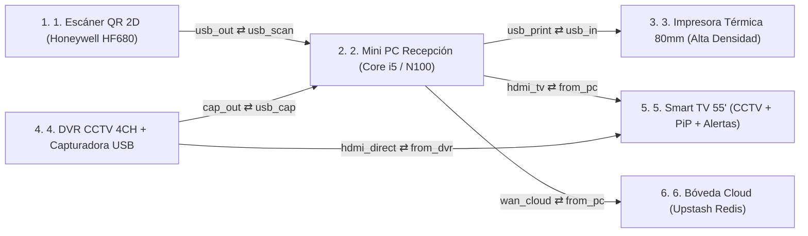

# RD Fitness Club: Escáner QR 2D ➔ Mini PC ➔ Impresora Térmica 80mm + Smart TV CCTV PiP ➔ Cloud Vault

_Anatomía 3D interactiva del ecosistema físico y digital: acceso QR en 0.1s, boletas negro puro y TV de cámaras con alertas y publicidad rotativa_

> Documento generado automáticamente por **Anatomy3D** · 2026-10-20T16:04:54.543Z

## Resumen ejecutivo

| Métrica | Valor |
|---|---|
| Equipos | 6 |
| Componentes internos | 42 |
| Etapas de proceso | 19 |
| Cables | 6 |
| Procesos trazables | 3 (17 pasos) |
| Pares de colisión verificados | 15502 |
| Auditoría geométrica | ✅ aprobada (0 errores, 0 advertencias) |
| **Puntaje de calidad** | **100/100** |

## Topología

## Fichas de equipo

### 1. Lector Óptico 2D Imager Omnidireccional (Honeywell Orbit HF680 / Netum NT-2050M)

Escáner de presentación manos libres con sensor CMOS megapíxel e iluminación antirreflejo. Lee códigos QR desde pantallas de celulares con brillo mínimo, micas rajadas o carnés plastificados en 0.1 segundos sin frustrar al socio.

| Especificación | Valor |
|---|---|
| Modelos | Honeywell Orbit HF680 / Zebra DS9308 / Netum NT-2050M |
| Sensor | CMOS 1280×800 Megapíxel (60 fps) |
| Tolerancia | Pantallas con 15% brillo, vidrio templado y QR densos |
| Interfaz | USB-HID Plug & Play (emulación de teclado instantánea) |

**Anatomía interna**

- **Placa base (PCB multicapa)** — Circuito impreso multicapa con planos de tierra y buses de alta velocidad entre los componentes.
- **ASIC Decodificador 2D QR** — Reconstruye el código QR con corrección Reed-Solomon incluso si la pantalla del celular está manchada o agrietada.
- **Buffer de Tramas y Debounce** — Almacena la cadena `RDFIT:SOCIO` y aplica bloqueo de rebote para evitar lecturas duplicadas accidentales.
- **Regulador 5V USB + Iluminación LED** — Alimenta la matriz de LEDs blancos cálidos sin parpadeo y el timbre piezoeléctrico de confirmación.
- **Sensor Óptico CMOS 60fps** — Captura 60 cuadros por segundo a través del lente gran angular con filtro antirreflejo para pantallas OLED/LCD.
- **Firmware HID + Sufijo Enter** — Memoria flash con el mapa de teclado español y envío automático de tecla ENTER al terminar el escaneo.
- **Ventilador PWM de enfriamiento** — Ventilador axial controlado por telemetría térmica que extrae el calor del chasis.

**Proceso interno**

1. **Captura Óptica Antirreflejo** — El sensor CMOS captura el QR desde la pantalla del celular o carné sin deslumbramiento.
2. **Decodificación Reed-Solomon** — El chip ASIC extrae el token `RDFIT:Mxxxx` en menos de 100 milisegundos.
3. **Emisión USB-HID + Beep Verde** — Envía la ráfaga USB-HID con sufijo ENTER hacia la Mini PC y emite el pitido de lectura exitosa.

| Puerto | Tipo | Cable | Conectado a |
|---|---|---|---|
| Ventana Óptica 2D (`qr_in`) | rj45 | — | — |
| Salida USB-HID a Mini PC (`usb_out`) | rj45 | c_scan_pc | minipc.usb_scan |

### 2. Estación Central de Recepción (Beelink Mini S12 Pro N100 / Core i5 16GB SSD Dual-HDMI)

Cerebro operativo del gimnasio. Ejecuta el servidor Express/Node.js, valida membresías en tiempo real, envía alertas SSE a la Smart TV de cámaras, dispara la impresión térmica en negro puro y sincroniza la bóveda local con Upstash Redis.

| Especificación | Valor |
|---|---|
| Hardware | Beelink Mini S12 Pro (Intel N100) o Mini PC Core i5, 16GB RAM, 512GB NVMe |
| Video | Doble salida HDMI 4K@60Hz (Monitor Recepción + Smart TV Gimnasio) |
| Resiliencia | Arquitectura Híbrida Offline-First (JSON Local + Upstash Redis) |
| Seguridad | Cifrado AES-256-GCM + Sesiones HMAC-SHA256 + Rate Limit |

**Anatomía interna**

- **Placa base (PCB multicapa)** — Circuito impreso multicapa con planos de tierra y buses de alta velocidad entre los componentes.
- **Procesador Intel Core i5 / N100 (Node.js)** — Ejecuta `server.js`: verifica vigencia de membresía, calcula arqueo de caja y coordina el bus SSE (`/api/screen/stream`).
- **RAM 16GB (Estado de Socios + SSE)** — Mantiene en memoria el padrón de socios, tokens de sesión y colas de eventos en tiempo real.
- ** Etapa VRM de Bajo Consumo (25W)** — Regulación térmica silenciosa para operación continua de 6:00 AM a 10:00 PM.
- **Controladora USB 3.2 + Dual HDMI + GbE** — Recibe la ráfaga del lector QR, el stream UVC de la capturadora del DVR y transmite video 1080p a la TV.
- **SSD NVMe 512GB (`gym.json` + Backups)** — Guarda la base de datos local transaccional y las copias de seguridad cifradas AES-256.
- **Ventilador PWM de enfriamiento** — Ventilador axial controlado por telemetría térmica que extrae el calor del chasis.

**Proceso interno**

1. **Recepción USB-HID / Captura DVR** — Recibe el código QR del socio o la orden de cobro Yape/Plin desde recepción.
2. **Validación de Membresía y Caja** — Verifica fecha de vencimiento (`endDate`), registra asistencia y emite evento SSE hacia la TV.
3. **Renderizado de Ticket #000000** — Genera el comprobante térmico monocromático 100% negro puro sin escalas de grises.
4. **Persistencia Dual (NVMe + Cloud)** — Guarda en disco local instantáneamente y replica hacia Upstash Redis en segundo plano.

| Puerto | Tipo | Cable | Conectado a |
|---|---|---|---|
| Entrada USB Escáner 2D (`usb_scan`) | rj45 | c_scan_pc | scanner.usb_out |
| Salida USB Impresora Térmica (`usb_print`) | rj45 | c_pc_print | printer.usb_in |
| Entrada USB 3.0 Capturadora DVR (`usb_cap`) | rj45 | c_dvr_pc | dvr.cap_out |
| Salida HDMI 2 hacia Smart TV (`hdmi_tv`) | rj45 | c_pc_tv | tv.from_pc |
| Uplink HTTPS hacia Upstash Cloud (`wan_cloud`) | rj45 | c_pc_cloud | cloud.from_pc |

### 3. Impresora Térmica de Boletas 80mm con Autocorte (Xprinter XP-N160II / Epson TM-T20III)

Impresora térmica directa configurada en modo monocromático de máxima densidadoscura (#000000 puro, sin tramado gris). Con papel térmico Hansol de 65g entrega boletas nítidas, intensas y legibles al instante.

| Especificación | Valor |
|---|---|
| Modelos | Xprinter XP-N160II (Calidad/Precio) o Epson TM-T20III (Industrial) |
| Cabezal | Rohm Japonés 203 DPI • Velocidad 200 mm/s • Vida útil 150 km |
| Papel | Rollo Térmico 80mm × 80m Gramaje 65g Capa Negra Intensa (Bisfenol-Free) |
| EstilosCSS | Forzado `#000000 !important`, `font-weight: 800/900`, `contrast(200%)` |

**Anatomía interna**

- **Placa base (PCB multicapa)** — Circuito impreso multicapa con planos de tierra y buses de alta velocidad entre los componentes.
- **Cabezal Térmico Rohm 203 DPI** — Aplica pulso térmico al 100% de densidad para quemar el papel térmico con negro sólido e intenso.
- **Motor Paso a Paso + Rodillo Siliconado** — Tracciona el rollo de 80mm a 200 mm/s con presión uniforme para evitar letras borrosas o pálidas.
- **Fuente 24V 2.5A Estabilizada** — Garantiza corriente pico constante para que el cabezal nunca imprima tenue cuando hay textos densos.
- **Interfaz USB ESC/POS + Buffer 64KB** — Recibe el mapa de bits monocromático desde la Mini PC sin pérdida de paquetes.
- **Guillotina Automática de Acero** — Realiza el corte parcial limpio del comprobante al finalizar la impresión del código QR del socio.
- **Ventilador PWM de enfriamiento** — Ventilador axial controlado por telemetría térmica que extrae el calor del chasis.

**Proceso interno**

1. **Recepción Raster Monocromático** — Recibe la boleta renderizada con CSS `#000000 !important` y QR de bordes nítidos (`crispEdges`).
2. **Termo-Impresión a Densidad Máxima** — El cabezal térmico quema el papel de 65g a máxima temperatura para lograr letras negras intensas.
3. **Autocorte y Entrega de Boleta** — La guillotina corta el ticket listo para entregar al socio con su código QR nítido.

| Puerto | Tipo | Cable | Conectado a |
|---|---|---|---|
| Entrada USB Impresión ESC/POS (`usb_in`) | rj45 | c_pc_print | minipc.usb_print |

### 4. Grabador DVR/NVR de Cámaras de Seguridad + Capturadora HDMI-USB 1080p

Centraliza las 4 cámaras de seguridad del gimnasio (Ingreso, Zona Pesas, Zona Cardio y Recepción). Mediante un Splitter HDMI o Capturadora HDMI-a-USB 3.0 inyecta el video en vivo dentro de `/display.html` para que la TV nunca pierda las cámaras.

| Especificación | Valor |
|---|---|
| Canales | 4 Cámaras Full HD 1080p (Ingreso, Musculación, Cardio, Caja) |
| Integración | Capturadora Video HDMI a USB 3.0 UVC 1080p60 (S/ 45) o Stream RTSP/MJPEG |
| Grabación | Disco Duro WD Purple Surveillance 24/7 H.265+ |
| Conmutación | Cero pérdida de grabación durante alertas QR o spots publicitarios |

**Anatomía interna**

- **Placa base (PCB multicapa)** — Circuito impreso multicapa con planos de tierra y buses de alta velocidad entre los componentes.
- **SoC Codificador H.265+ Multi-Vista** — Combina las 4 cámaras en la cuadrícula 2×2 con marca de tiempo REC en tiempo real.
- **Capturadora HDMI-a-USB 3.0 (UVC)** — Convierte la salida HDMI del DVR en una fuente de cámara USB estándar (`getUserMedia`) para la Mini PC.
- **Fuente 12V Dedicada CCTV** — Alimentación continua para el grabador y las cámaras infrarrojas.
- **Entradas Coaxiales / PoE 4 Cámaras** — Recibe la señal en vivo de las 4 cámaras estratégicas del gimnasio.
- **Disco WD Purple Vigilancia 24/7** — Graba de forma ininterrumpida las 24 horas aunque la TV esté mostrando una bienvenida o un spot.
- **Ventilador PWM de enfriamiento** — Ventilador axial controlado por telemetría térmica que extrae el calor del chasis.

**Proceso interno**

1. **Ingesta de 4 Cámaras CCTV** — Recibe el video continuo de Puerta Principal, Zona de Pesas, Cardio y Recepción.
2. **Composición Cuadrícula 2×2 + Grabación** — Guarda el flujo H.265+ en disco y genera la vista cuádruple 1080p.
3. **Inyección HDMI-USB a `/display.html`** — Entrega el video en vivo al navegador de la Mini PC para mostrarlo a pantalla completa o en PiP.

| Puerto | Tipo | Cable | Conectado a |
|---|---|---|---|
| Salida Capturadora HDMI-USB a Mini PC (`cap_out`) | rj45 | c_dvr_pc | minipc.usb_cap |
| Bus de Video CCTV hacia Smart TV (`hdmi_direct`) | rj45 | c_dvr_tv | tv.from_dvr |

### 5. Smart TV del Gimnasio: Monitor CCTV 24/7 + PiP Automático + Alertas QR/Yape + Publicidad Rotativa

Reemplaza por completo la necesidad de comprar una Tablet adicional. Muestra las cámaras de seguridad a pantalla completa el 90% del tiempo y, cuando un socio pasa su QR o realiza un Yape, encoge las cámaras a una esquina Picture-in-Picture (PiP) por 5.5s para mostrar la bienvenida o el QR de pago. Además, cada X minutos lanza un Spot Publicitario del gimnasio por 16s.

| Especificación | Valor |
|---|---|
| ModoBase | Cámaras de Seguridad CCTV 4 Canales a Pantalla Completa (90% del tiempo) |
| InterrupcionQR | Prioridad Alta (5.5s): Bienvenida Socio, Salida o Alerta Roja de Vencimiento + Audio |
| ModoYape | Prioridad Alta: Muestra QR Yape/Plin gigante con monto exacto y confirma el pago |
| ModoSpot | Rotación Programada (cada 3 min por 16s): Planes, Tarifas y App Entrenador con CCTV en PiP |

**Anatomía interna**

- **Placa base (PCB multicapa)** — Circuito impreso multicapa con planos de tierra y buses de alta velocidad entre los componentes.
- **Conmutador Inteligente de Escena (TV Mode)** — Alterna sin parpadeos entre Vista Completa CCTV, Alerta Prioritaria QR/Yape y Spot Publicitario.
- **Motor Picture-in-Picture (PiP Flotante)** — Mantiene las 4 cámaras visibles en la esquina inferior derecha mientras se proyecta una alerta o publicidad.
- **Sintetizador de Voz y Campanilla WebAudio** — Emite el sonido de acceso concedido, alerta de membresía vencida o confirmación de Yape.
- **Receptor HDMI 2.0 + Cliente SSE** — Recibe la señal de `/display.html` con reconexión automática ante cualquier microcorte.
- **Programador de Spots Publicitarios** — Temporizador configurable (cada 2, 3, 5 o 10 min) que exhibe planes y promociones de RD Fitness Club.
- **Ventilador PWM de enfriamiento** — Ventilador axial controlado por telemetría térmica que extrae el calor del chasis.

**Proceso interno**

1. **Recepción de Video CCTV + Eventos SSE** — Mantiene en pantalla las 4 cámaras del gimnasio y escucha eventos en `/api/screen/stream`.
2. **Transición Suave a Picture-in-Picture (PiP)** — Al detectar un escaneo QR, cobro Yape o turno publicitario, reduce las cámaras al recuadro PiP.
3. **Proyección de Bienvenida / Yape / Spot** — Muestra el nombre del socio y días restantes (5.5s) o el Spot Publicitario (16s) y luego restaura las cámaras.

| Puerto | Tipo | Cable | Conectado a |
|---|---|---|---|
| Entrada Video Cámaras CCTV (`from_dvr`) | rj45 | c_dvr_tv | dvr.hdmi_direct |
| Entrada HDMI desde Mini PC (/display.html) (`from_pc`) | rj45 | c_pc_tv | minipc.hdmi_tv |

### 6. Bóveda en la Nube Upstash Redis + Sincronización Google Sheets y WhatsApp

Respaldo externo instantáneo en la nube (`wise-pipefish-172734.upstash.io`). Garantiza que aunque la PC sufra un desperfecto físico, el 100% de socios, membresías, asistencias y caja estén a salvo y accesibles desde el celular del dueño.

| Especificación | Valor |
|---|---|
| MotorCloud | Upstash Redis Serverless TLS (`wise-pipefish-172734.upstash.io`) |
| Arquitectura | Write-Through Asíncrono + Auto-hidratación al arranque |
| Exportacion | Sincronización con Google Sheets, Excel CSV UTF-8 BOM y Boletas WhatsApp |
| Seguridad | Token REST Bearer + Copias cifradas AES-256-GCM |

**Anatomía interna**

- **Placa base (PCB multicapa)** — Circuito impreso multicapa con planos de tierra y buses de alta velocidad entre los componentes.
- **Motor Redis (`rd_fitness:vault:v4`)** — Actualiza atómicamente el estado maestro del gimnasio en milisegundos.
- **Caché Distribuida Multi-AZ** — Sirve la App del Miembro (`/app`) y el panel gerencial móvil desde cualquier lugar.
- **Conector Webhook Google Sheets / WhatsApp** — Permite exportar reportes ejecutivos y enviar comprobantes digitales al WhatsApp del socio.
- **Gateway HTTPS / TLS 1.3 Serverless** — Recibe las réplicas JSON comprimidas desde la Mini PC de recepción.
- **Persistencia Duradera + Snapshots** — Almacena el historial contable, cierres de caja y auditoría anti-fraude.
- **Ventilador PWM de enfriamiento** — Ventilador axial controlado por telemetría térmica que extrae el calor del chasis.

**Proceso interno**

1. **Ingesta Segura REST TLS 1.3** — Recibe la actualización del estado tras cada cobro, registro o asistencia.
2. **Commit Atómico en Bóveda Redis** — Guarda la clave `rd_fitness:vault:v4` con replicación redundante.
3. **Disponibilidad Móvil 24/7 para el Dueño** — El propietario consulta reportes, ingresos y asistencias en vivo desde su celular.

| Puerto | Tipo | Cable | Conectado a |
|---|---|---|---|
| Enlace TLS 1.3 desde Mini PC (`from_pc`) | rj45 | c_pc_cloud | minipc.wan_cloud |

## Inventario de cableado

| Cable | Medio | Origen | Destino | Longitud (u) |
|---|---|---|---|---|
| c_scan_pc | PoE / alimentación | scanner.usb_out | minipc.usb_scan | 33.4 |
| c_pc_print | Ethernet | minipc.usb_print | printer.usb_in | 33.4 |
| c_dvr_pc | Coaxial RF | dvr.cap_out | minipc.usb_cap | 106.4 |
| c_pc_tv | WAN / enlace externo | minipc.hdmi_tv | tv.from_pc | 36.4 |
| c_dvr_tv | Ethernet | dvr.hdmi_direct | tv.from_dvr | 33.4 |
| c_pc_cloud | PoE / alimentación | minipc.wan_cloud | cloud.from_pc | 106.4 |

## Procedimientos / flujos de proceso

### 1. Ingreso QR Instantáneo (0.1s): Socio ➔ Escáner 2D ➔ Mini PC ➔ Smart TV (PiP + Bienvenida) ➔ Cloud

_Duración simulada: 11.9s_

1. **Óptico QR 2D** (member_qr) — El socio acerca su celular o carné QR al lector 2D de recepción.
2. **Decodificación 0.1s** (scanner) — El sensor CMOS antirreflejo captura el QR en 0.1s, decodifica `RDFIT:SOCIO` y lo envía por USB-HID.
3. **USB-HID Instantáneo** (c_scan_pc) — La trama viaja por el cable USB blindado hacia la Mini PC de recepción.
4. **Validación + Evento SSE** (minipc) — La Mini PC verifica que la membresía está ACTIVA, registra la asistencia y dispara el evento `welcome` hacia la TV.
5. **HDMI 1080p + SSE** (c_pc_tv) — La señal viaja por el cable HDMI hacia la Smart TV del gimnasio.
6. **PiP CCTV + Bienvenida 5.5s** (tv) — La TV pasa las cámaras de seguridad a la esquina PiP, muestra la bienvenida con los días restantes del socio por 5.5s y luego vuelve a las cámaras a pantalla completa.

### 2. Cobro de Membresía / Yape + Boleta Térmica Negro Puro (#000000) + Respaldo Cloud

_Duración simulada: 12.6s_

1. **POS Caja + Render #000000** (minipc) — Recepción registra el pago (Efectivo/Yape/Plin) y genera la boleta con CSS monocromático 100% negro puro.
2. **USB ESC/POS 203 DPI** (c_pc_print) — El comprobante de alto contraste se envía por USB a la impresora térmica de 80mm.
3. **Impresión Alta Densidad** (printer) — El cabezal Rohm quema el papel térmico Hansol de 65g con negro intenso y corta el ticket automáticamente.
4. **Replicación Híbrida** (minipc) — En paralelo, la Mini PC empaqueta el nuevo estado contable y lo envía hacia Upstash Redis.
5. **HTTPS TLS 1.3** (c_pc_cloud) — Sincronización cifrada hacia la nube.
6. **Cloud Vault Sync** (cloud) — Upstash Redis confirma el respaldo en la nube: el dueño ya ve el ingreso en tiempo real desde su celular.

### 3. Ciclo Smart TV: Cámaras CCTV 24/7 (DVR) ➔ Spot Publicitario Programado (16s con PiP) ➔ Retorno a CCTV

_Duración simulada: 10s_

1. **CCTV 4 Canales 1080p** (dvr) — El DVR graba las 4 cámaras 24/7 y entrega la señal de video por la capturadora HDMI-USB.
2. **Video USB 3.0 UVC 60fps** (c_dvr_pc) — El flujo de las cámaras ingresa a la Mini PC para integrarse en `/display.html`.
3. **Matriz de Video CCTV** (dvr) — El enlace directo de video mantiene sincronizada la cuadrícula 2×2 de vigilancia.
4. **Bus Video CCTV** (c_dvr_tv) — Transmisión continua hacia la Smart TV.
5. **Spot Rotativo 16s + CCTV PiP** (tv) — Cada 3 minutos la TV lanza automáticamente el Spot Publicitario de RD Fitness Club durante 16 segundos (manteniendo las cámaras en la esquina PiP) y al terminar regresa a las cámaras a pantalla completa.

## Resultado de auditoría

✅ Sin errores geométricos ni de proceso.

### Scorecard

| Criterio | Puntos |
|---|---|
| Geometry audit (0 errors) | 30/30 |
| Zero warnings | 10/10 |
| Internal anatomy (>=5 parts/device) | 15/15 |
| Process pipelines (>=3 stages/device) | 10/10 |
| End-to-end traces (>=3) | 10/10 |
| Trace coverage of cables | 10/10 |
| Live controls + telemetry | 10/10 |
| Documented devices (desc+specs) | 5/5 |
